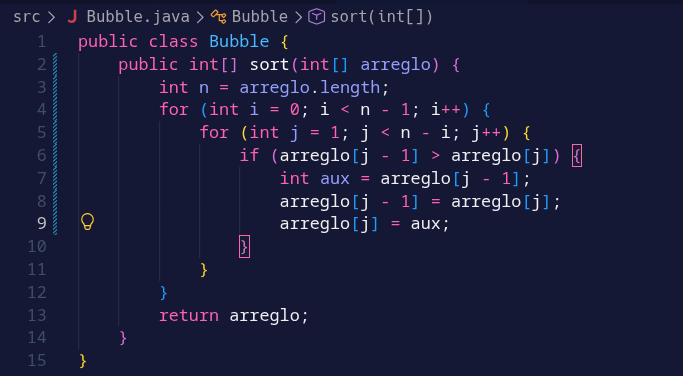

# PC 1.1.1
Metodo burbuja

Recorre el arreglo comparando cada elemento con el anterior. Si el anterior es mayor, los intercambia, y repite hasta dejar los numeros de menor a mayor.

Resultado

El arreglo original 5 - 6 - 4 - 1 - 2 - 3 queda ordenado como 1 - 2 - 3 - 4 - 5 - 6.

